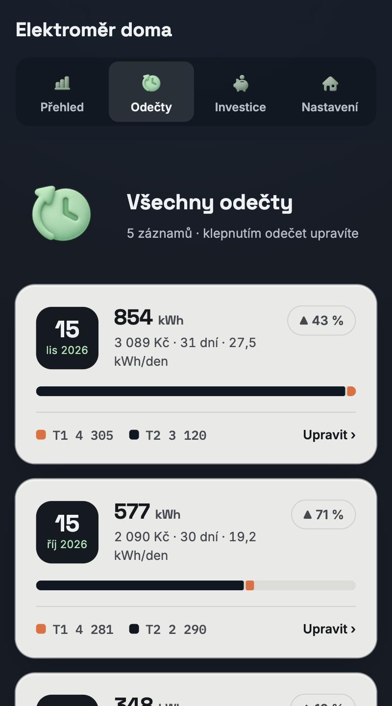

# Elektroměr doma

Mobilní stránka na měsíční samoodečty dvoutarifového elektroměru: stav z fotky, spotřeba a cena po obdobích, grafy, zálohy, výhled na 12 měsíců a orientační návratnost úsporných technologií.

Běží jako Claude Artifact. Odečty ukládá do databáze artifactu a stav z fotky čte přes Clauda, takže stránka otevřená mimo Clauda (například přes GitHub Pages) data nenačte ani neuloží.

## Ukázka

  
  
  
  

Hodnoty na obrázcích jsou vymyšlené.

## Struktura

| Soubor | Obsah |
|---|---|
| `index.html` | kostra stránky |
| `css/styles.css` | vzhled |
| `js/app.js` | start, vykreslení obrazovek, záložky, nastavení |
| `js/model.js` | výpočty spotřeby, výhledu a návratnosti |
| `js/charts.js` | kreslení grafů do SVG |
| `js/sheet.js` | formulář odečtu a čtení z fotky |
| `js/motion.js` | úvodní obrazovka a animace |
| `js/state.js` | stav aplikace a výchozí nastavení |
| `js/util.js` | formátování čísel a dat |
| `icons/` | ikony |
| `docs/` | obrázky do tohoto README |

Bez build kroku, čisté ES moduly.
