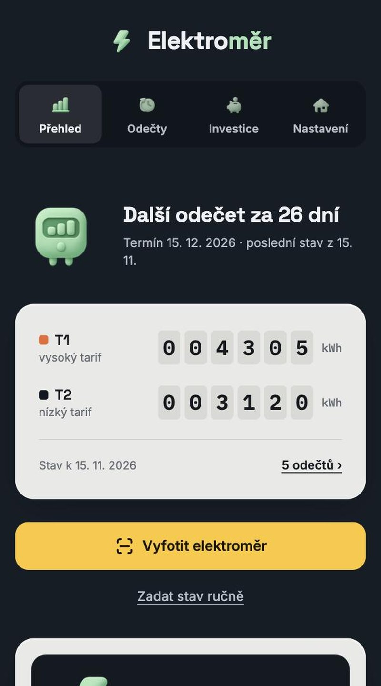
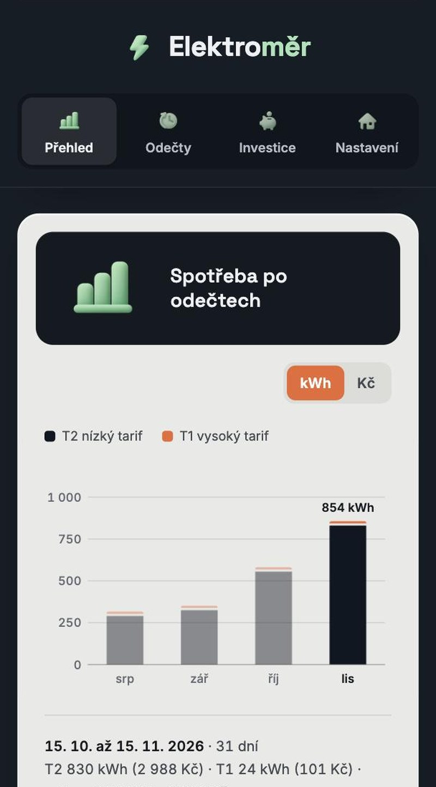
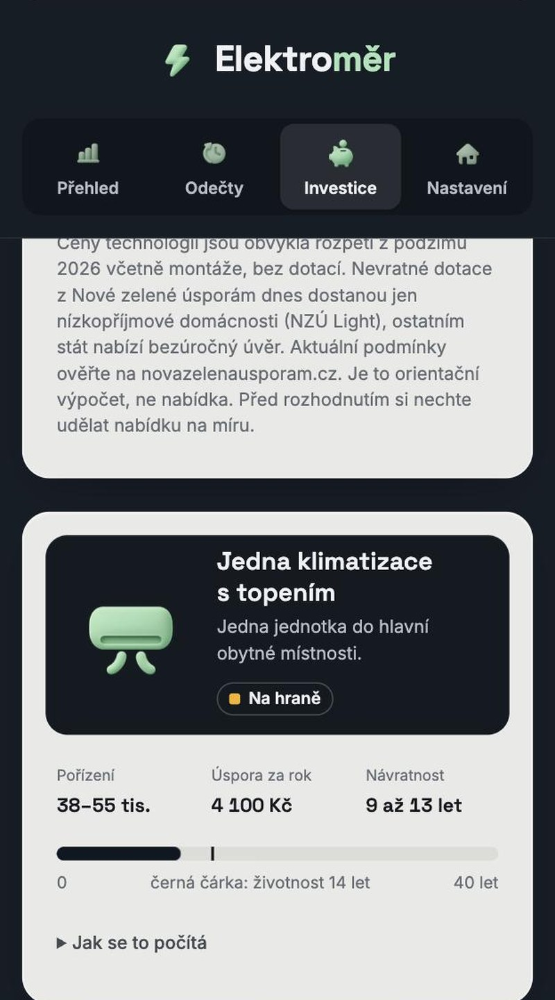

# Elektroměr

Mobilní stránka na měsíční samoodečty dvoutarifového elektroměru: stav z fotky, spotřeba a cena po obdobích, grafy, zálohy, výhled na 12 měsíců a orientační návratnost úsporných technologií.

Běží jako Claude Artifact. Odečty ukládá do databáze artifactu a stav z fotky čte přes Clauda, takže stránka otevřená mimo Clauda (například přes GitHub Pages) data nenačte ani neuloží.

## Ukázka

<p>
  
  
  
  
</p>

Hodnoty na obrázcích jsou vymyšlené.

## Co umí

- **Odečet z fotky.** Vyfotíte displej elektroměru, stavy T1 a T2 se předvyplní a před uložením je potvrdíte. Jde zadat i ručně.
- **Přehled.** Poslední stav, spotřeba a cena za období, změna proti minulému, graf po odečtech v kWh nebo Kč a průměr na den.
- **Zálohy.** Porovnání zaplacených záloh se skutečnou spotřebou a odhad přeplatku nebo nedoplatku za rok.
- **Výhled.** Odhad spotřeby na dalších 12 měsíců podle spotřeby mimo topení a běžného průběhu topné sezóny.
- **Odečty.** Seznam všech odečtů s cenou, pruhem spotřeby a možností úpravy.
- **Investice.** Orientační návratnost devíti úsporných technologií, seřazená podle výhodnosti vůči životnosti.

## Technologie

React 19, TypeScript, Tailwind CSS 4 a Vite.

```bash
npm install
npm run dev
npm run build
```

`npm run build` zkontroluje typy, sestaví aplikaci do `dist/` a vytvoří `dist/artifact.html`, což je stránka, která se publikuje jako Claude Artifact spolu se soubory z `dist/assets/` a `dist/icons/`.

## Struktura

| Cesta | Obsah |
|---|---|
| `src/App.tsx` | kostra aplikace, záložky, úvodní obrazovka |
| `src/views/` | obrazovky Přehled, Odečty, Investice a Nastavení |
| `src/components/` | sdílené prvky, grafy a formulář odečtu |
| `src/lib/model.ts` | výpočty spotřeby, výhledu a návratnosti |
| `src/lib/store.ts` | načítání a ukládání dat přes Clauda |
| `src/lib/motion.ts` | animace a pozorování viditelnosti |
| `src/lib/format.ts` | formátování čísel a dat |
| `src/index.css` | téma Tailwindu a animace |
| `public/icons/` | ikony |
| `docs/` | obrázky do tohoto README |
